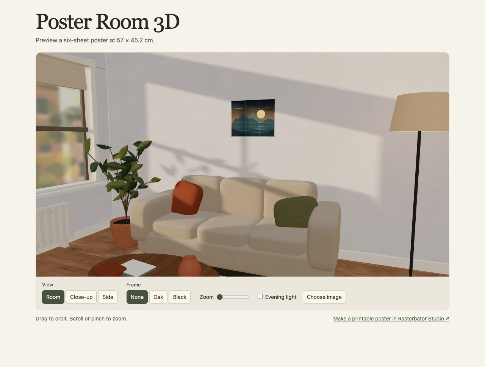
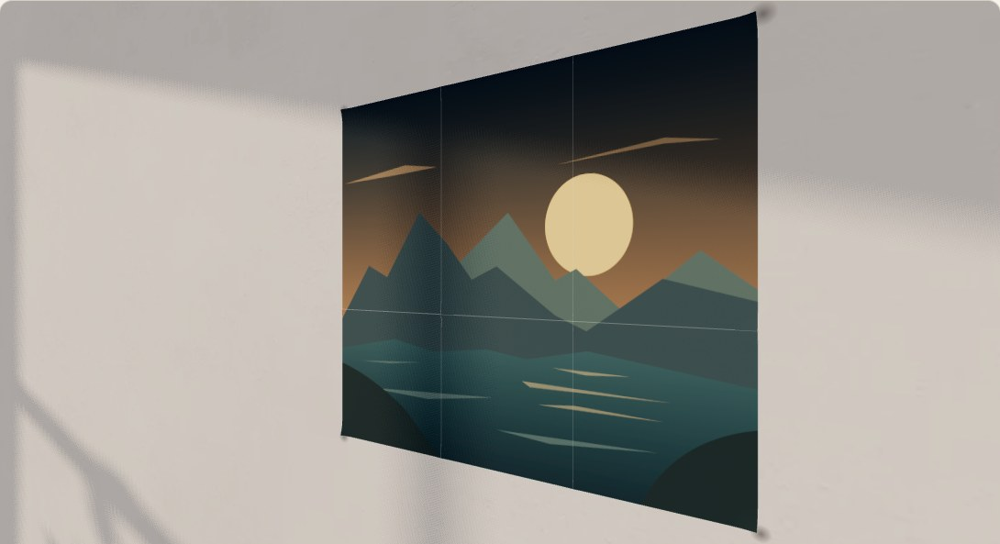

# Poster Room 3D — Three.js Wall Art Visualizer

An open-source Three.js room preview for tiled wall posters. Place your own artwork in a furnished living room, orbit the camera and inspect paper seams before printing. The demo uses TypeScript, WebGL and Vite.

Want to print your image? [Make a tiled poster PDF in Rasterbator Studio](https://rasterbator.online/#workspace).



## Run the demo

Use Node.js 22.12 or later in the 22.x release line (or a newer supported LTS release).

```sh
npm ci
npm run dev
```

Open the local URL printed by Vite. To verify the production build, run `npm run build` and then `npm run preview`.

The default poster measures 570 × 452 mm and uses six A4 sheets. Drag to orbit the room and scroll or pinch to zoom. Use **Side** to see the paper seams and curled corners, or switch between unframed, oak and black display styles. **Choose image** previews a local image in the same layout. Your image stays in the browser.



## Use the viewer in a Three.js project

Copy the viewer and its layout modules from `src/`, along with `public/paper/room-materials/`. The texture loader uses Vite’s `import.meta.env.BASE_URL`. If you use another bundler, set that path to your static assets directory.

Give your host element a width and height, then create a scene with an image URL and a layout in millimeters:

```ts
import { makeLayout } from './poster-geometry';
import { createRoomScene } from './poster-room-scene';

const layout = makeLayout(570, 452, 210, 297, 10, 5, false, {
  overlapInMargins: true,
});
const viewer = await createRoomScene(
  host, imageUrl, imageWidth / imageHeight, layout,
  () => console.warn('WebGL context lost'),
  (zoom) => console.log(zoom),
);

viewer.frame('none');
viewer.focusPoster(true);

// When unmounting the host:
viewer.dispose();
```

Serve artwork from the same origin, from a CORS-enabled origin, or from a local file picker via a blob URL. The bundled demo uses a fixed six-sheet layout. The printable PDF workflow is available in Rasterbator Studio.

## Source

- `src/poster-room-scene.ts` builds the room, lighting, camera controls and frame options. Call `createRoomScene` with a sized host element, image URL, aspect ratio and layout. Call `dispose()` when removing the viewer.
- `src/poster-room-paper.ts` generates sheet surfaces, edges and lifted corners.
- `src/poster-room-geometry.ts` maps poster sheets and panels to room geometry. Layout dimensions are in millimeters.

## License

The code and original sample poster are available under the [MIT License](LICENSE). The [room texture maps](public/paper/room-materials/LICENSE.md) are from Poly Haven and available under CC0 1.0.
